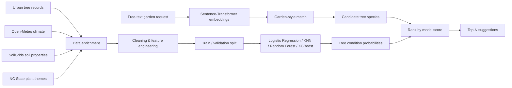
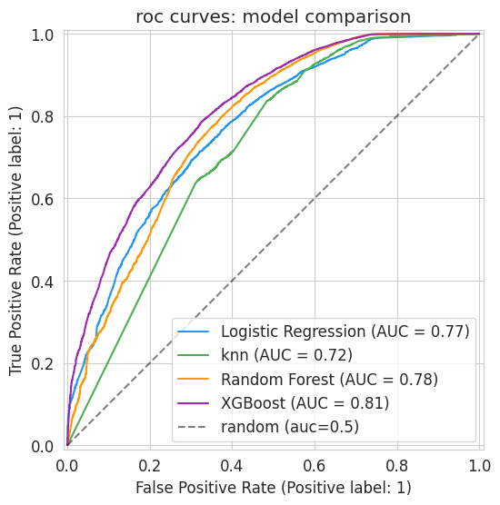
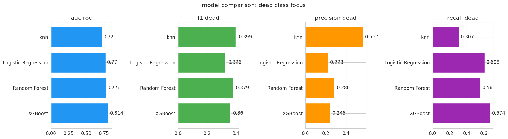
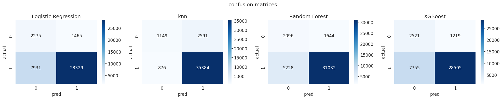
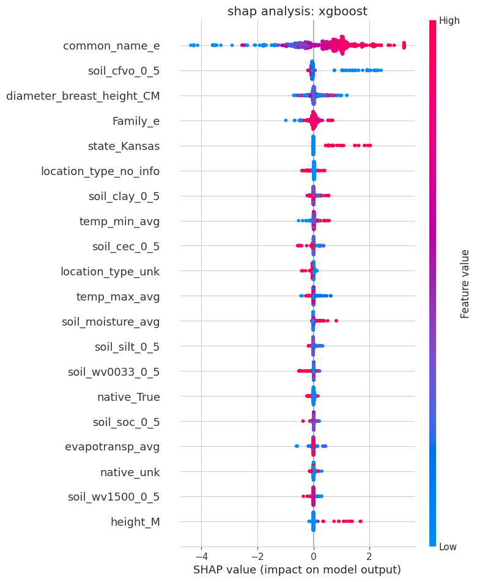

# 🌿 Plant Selection ML

### Data-driven tree condition prediction & landscape-style recommendations

   

> **Goal:** help urban forestry and landscape-design teams explore tree condition risk and shortlist species that match a requested garden aesthetic.

This is a **two-stage research prototype** developed from urban tree inventory records enriched with soil and climate information. It combines tabular machine learning for tree condition classification with semantic matching for garden-style recommendations.

**[Explore notebooks](notebooks/)** · **[Results](#model-results)** · **[Data provenance](#data-sources--preparation)** · **[Presentation](presentation/Plant-Selection-ML.pptx)**

---

## ✨ What the project does



### Stage 1 — Tree condition classification

- Predict a **binary status label** from species, location and environmental features.
- Compare **Logistic Regression, KNN, Random Forest, and XGBoost**.
- Evaluate **ROC-AUC, class-0 F1, precision, recall**, plus confusion matrices.
- Explore feature contributions with **SHAP**.

### Stage 2 — Garden-style recommendations

- Match a free-text design description with available landscape themes using **`all-MiniLM-L6-v2`** and cosine similarity.
- Identify candidate species linked to the selected theme.
- Use the trained **XGBoost** model to rank candidates by its predicted positive-class score.
- Return a **Top-N shortlist**.

## 📊 Model results

Results below are taken from **saved notebook outputs from the original experiment** (200,000-row sample mode, with an 80/20 split), **not** from rerunning the included small sample CSV.

| Model | ROC-AUC ↑ | F1 (class 0) ↑ | Recall (class 0) ↑ |
|---|---:|---:|---:|
| Logistic Regression | 0.770 | 0.326 | 0.608 |
| KNN | 0.719 | **0.399** | 0.301 |
| Random Forest | 0.776 | 0.379 | 0.560 |
| **XGBoost** | **0.814** | 0.360 | **0.674** |

**XGBoost had the highest ROC-AUC and class-0 recall; KNN had the highest class-0 F1.** These metrics measure different tradeoffs and do not establish out-of-sample future survival rates.



<details>
<summary>More evaluation figures: model comparison, confusion matrices, SHAP</summary>







</details>

## 🌎 Data sources & preparation

| Source | Contribution | Method |
|---|---|---|
| [Dryad urban tree data](https://doi.org/10.5061/dryad.2jm63xsrf) | Tree inventory, species, observed condition | CSV import |
| [Open-Meteo historical API](https://open-meteo.com/) | Climate averages, precipitation, frost, soil moisture/temperature | REST API |
| [SoilGrids](https://soilgrids.org/) | Soil pH, texture, carbon, nutrients | REST API |
| [NC State Plant Toolbox](https://plants.ces.ncsu.edu/) | Landscape-theme tags | `requests` + `BeautifulSoup` |

Data flow: **import → aggregate environmental features → collect landscape themes → combine/clean → export enriched CSV → preprocess for ML.**

The data-collection notebook contains code that saves `env.csv`, `soil.csv`, and `my_plants_data.csv`. However, it also loads an intermediate `merged_city_result-2.csv` that is **not included**, so the complete original assembly process is **not one-click reproducible** from the provided files. Some upstream API or website behavior may also have changed.

The **full enriched CSV (~412 MB)** is intentionally excluded from GitHub. See [data/README.md](data/README.md) for details. The repo includes a small `data/sample_plants.csv` for inspection and quick tests only.

## 🗂️ Repository structure

```text
plant-selection-ml/
├── README.md
├── requirements.txt
├── notebooks/
│   ├── 01_data_collection.ipynb       # Collection, web scraping, CSV exports (Colab)
│   ├── 02_modeling.ipynb              # Local-friendly data-path modification
│   └── 02_modeling_original.ipynb     # Unmodified original with saved outputs
├── data/
│   ├── README.md
│   └── sample_plants.csv              # Small example, not full training data
├── assets/                            # Figures extracted from saved results
├── presentation/
│   └── Plant-Selection-ML.pptx
└── LICENSE-NOTE.md
```

## 🚀 Quick start

Requires Python 3.10+ (suggested). Notebook dependencies may need adjustment depending on your environment and library versions.

```bash
git clone https://github.com/YOUR_USERNAME/plant-selection-ml.git
cd plant-selection-ml
python -m venv .venv
# macOS / Linux
source .venv/bin/activate
# Windows PowerShell: .venv\Scripts\Activate.ps1
pip install -r requirements.txt
jupyter lab
```

Open `notebooks/02_modeling.ipynb`. **Run Jupyter from the repository root**, so the relative path `data/sample_plants.csv` resolves. This exploratory sample is much smaller and may yield different or unstable metrics. The original reported metrics are stored in `02_modeling_original.ipynb`.

To use the full dataset instead, set the variable inside the notebook or export an environment variable before starting Jupyter:

```bash
export PLANTS_DATA_PATH=/absolute/path/to/my_plants_data.csv
```

**Note:** `01_data_collection.ipynb` is an original, Colab-oriented research notebook (Google Drive paths, interactive upload, external API calls). It is retained to show methodology, not presented as a standalone automated ETL script.

## 🔬 Methodological caveats

- The label describes **observed current status / mortality proxy**, not verified survival after a future planting event. Calling it a *prospective survival probability* would overstate the evidence.
- Environmental variables are aggregated at **state-level or representative coordinates** in parts of the pipeline, which limits site-specific claims.
- A random validation split may share spatial or species patterns across splits; geographic/temporal holdout tests would be useful next.
- The recommendation stage is a **prototype**: semantic matching and model ranking were demonstrated, not externally validated with landscape designers or real plantings.
- Current notebooks include some Colab assumptions and original saved outputs; figures report the original run rather than a fresh reproducibility audit.

## 🛠️ Tech stack

**Data:** Python, pandas, NumPy, Requests, BeautifulSoup, Open-Meteo, SoilGrids  
**ML:** scikit-learn, XGBoost, PCA, SHAP  
**NLP:** Sentence-Transformers (`all-MiniLM-L6-v2`), PyTorch  
**Visualization:** Matplotlib, Seaborn, Jupyter

## 📎 Presentation & attribution

The [project presentation](presentation/Plant-Selection-ML.pptx) summarizes motivation, data collection, model comparisons, feature analysis and example recommendations. Please review redistribution rights for any third-party images before publishing the deck publicly.

See [LICENSE-NOTE.md](LICENSE-NOTE.md) before applying an open-source license or publishing third-party data.

---

*Research/portfolio project. Not a validated planting decision-support product.*
